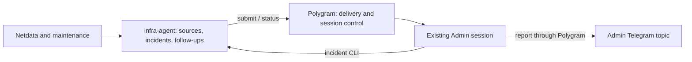

# Infrastructure assistant separation - Plan

> Superseded on 2026-10-17 by [Admin assistant with shared history and Netdata alerts](INFRA_ADMIN_AGENT_SPEC.md).
> This document records the deployed 0.40.0 design and its original implementation plan.
> Its incident ownership, claim/report completion and periodic fallback requirements are historical;
> they must not be carried into the replacement. Production migration has not occurred.

## Goal Capsule

Objective: Ivan's persistent Admin assistant receives infrastructure alerts and follows unresolved incidents, while infrastructure integrations evolve independently of Polygram releases.
Means: a separate infrastructure application using Polygram's general external-session input API (KTD1–KTD3).
Authority: the user's architecture correction supersedes the embedded design in `docs/INFRA_ADMIN_AGENT_SPEC.md`; AGENTS.md governs reviewed design alignment and implementation review.
Execution: update PR #119 without rewriting history, preserve extracted code and regression coverage, then review both sides of the interface.
Stop on incompatible existing state or a required live operation outside the agreed scope.
The root implementer owns integration and evidence; production activation is excluded.

---

## Product Contract

### Summary

Polygram accepts an external job for a configured conversation and exposes its delivery status.
A separate `infra-agent` application collects alerts, owns incidents and follow-ups, and submits diagnostic jobs to the existing Admin conversation.
The first stage remains diagnosis and reporting; automatic repairs require separately agreed runbooks.

### Problem Frame

PR #119 embeds Netdata parsing, infrastructure state, diagnostic instructions and incident lifecycle in a general Telegram/session daemon.
The original delivery gap remains: direct Telegram notifications do not enter an agent turn, and existing IPC `send` is notification-only.

### Requirements

#### Ownership

- R1. Polygram runs and packages without infrastructure-specific code, commands, tables, configuration or prompts.
- R2. The infrastructure application owns source polling/spooling, incidents, verification, follow-up policy and diagnostic instructions.
- R3. External jobs reuse the configured existing conversation with the same admission, recovery and busy lifecycle as human turns.

#### Delivery and control

- R4. Repeated submission with the same identity and content returns the existing job; conflicting content is rejected.
- R5. Acceptance, execution and reporting are distinguishable; uncertain execution never triggers automatic generic replay.
- R6. An authorized human stop persistently pauses external turns for that destination; only an authorized human resume removes the pause.
- R7. Infrastructure intake continues while execution is unavailable or paused, retaining evidence and surfacing coverage failures through its notification-only fallback.

#### Preserved behavior

- R8. Preserve fresh recovery verification, explicit maintenance states, pagination, cursor recovery, bounded notifications and recovery-report retries from the original implementation.
- R9. Preserve existing notifications and diagnosis-only policy; no automatic repair, provider change or live deployment is included.

### Scope Boundaries

No plugin framework, HTTP listener, message broker, general workflow scheduler or new LLM runtime is needed.
Polygram owns delivery of submitted work; the caller owns when to investigate again.
The existing same-user IPC credential remains the trust boundary; route allowlists are not separate tenant credentials.
No 24/7 availability or enforced read-only sandbox is claimed.

---

## Planning Contract

### Key Technical Decisions

- KTD1. Extract a separately installable `infra-agent` project with its own package, config, SQLite, CLI and collector LaunchAgent; Polygram has no dependency on it. (session-settled: user-approved — chosen over embedded handling: Polygram is universal.) The repository location remains the assumption below.
- KTD2. Add short authenticated asynchronous IPC submit/status operations. Configured route IDs map to bot-local chat/topics; callers cannot override destination, backend, model, cwd or permissions. The envelope contains a caller request ID, route ID, trusted task text and separate untrusted JSON payload.
- KTD3. Keep only a durable job ledger and destination pause in Polygram: identity, frozen target, bounded envelope, lifecycle timestamps, turn identity, bounded ordinary report content, per-part delivery outcomes and report receipt. There are no host, alarm, severity, incident or recovery fields.
- KTD4. Initially retain explicit Claude CLI support. Unsupported backends fail before dispatch; there is no silent fallback. The API and schema stay backend-neutral, but other adapters need their own lifecycle evidence.
- KTD5. The infra application uses Polygram's public IPC client (`package.json` main) and documented operations with protocol version discovery. It neither imports Polygram internals nor opens its DB. Extract necessary sanitization with its tests without inventing a shared library for one consumer.
- KTD6. A short periodic infra controller collects sources, reconciles submitted jobs and submits due investigations without waiting for LLM completion. Agent CLI operations access its own owner-only SQLite using transactions and optimistic revisions; a single-owner guard prevents overlapping controller ticks.

### Data Flow

### External Job Contract

Acknowledgement means the job was committed, not that an agent ran.
Identity is bot + route + caller request ID; persist the accepted envelope and resolved destination.
A repeated ID compares canonical content and returns existing status even after route changes.
Retain a digest of original canonical content alongside sanitized durable content so redaction cannot collapse conflicting requests.
Bound envelopes to 32 KiB and reject excess queue capacity before acceptance.
Keep completed identity records in this first stage; do not silently expire deduplication guarantees.
Queued work for a removed, disabled or retargeted route is held with a visible reason, never redirected.

Expose `queued`, `running`, `succeeded`, `failed`, `interrupted` and `unknown`, plus report outcome and reason.
Persist `running` before the side-effectful dispatch boundary.
Provably pre-dispatch busy/auth conditions leave work queued; ambiguous dispatch errors or crashes leave it unknown.
Never automatically turn unknown back into queued.
After restart, wait for existing session recovery and establish old-turn inactivity before admitting more work for that destination; otherwise hold it visibly.
Known terminal errors and interruptions also require a new caller decision; this can be an explicit application policy rather than a human approval.
Status exposes whether the old turn is positively known inactive, based on the existing recovery barrier and process/busy evidence for that exact session. A missing process record or expired timeout alone is not proof.
The infra controller records unknown/failed work as blocked, retains the incident and alerts the operator. Once the old turn is positively inactive and the destination unpaused, its diagnosis-only policy can schedule a fresh read-only reconciliation under the existing follow-up interval/backoff. Freeze a new request linked to the previous attempt; retain the previous job's unknown or failed outcome. This never retries the generic job or repeats a repair, and human interruptions remain paused until human resume.

Completion does not prove health recovery.
Preserve existing Channels and ordinary Telegram receipt evidence, exposing partial or ambiguous reporting explicitly.
Before ordinary Telegram delivery, persist bounded report content and stable part identities in the generic ledger. Polygram owns report-only retries of definitively unsent parts, without regenerating an agent turn; persist each part's outcome and receipt. Mark a part as sending before the transport call, and treat a lost response or crash during that call as ambiguous, never as safely unsent. Ambiguous parts remain visible for operator reconciliation rather than automatic resend.
Channels acknowledgements record observed sends; they do not prove a final recovery report. Do not reconstruct or replay opaque Channels output. Missing or ambiguous completion/report evidence stays unresolved, without claiming recovery was reported.
Agent execution outcome and report outcome are independent in status, so a completed diagnosis with a pending report is not misclassified as a diagnostic failure.
The wrapper marks payload as untrusted data; task text is privileged under the existing same-user trust model.
Exactly-once LLM side effects and Telegram delivery are not promised.

### Human Controls

Replace `/infra` with generic `/automation status`, `/automation pause`, `/automation resume` in configured destinations.
Pause blocks external turns while human conversation continues.
Key pause and admission by the actual effective session destination, not the route label: alias routes to the same conversation share one pause. Validate configured chat/topic destinations, requiring topic isolation for forum routes so external work cannot escape into another conversation.
The abort hook persists pause before interruption, including idle stop.
Use the shared admission lock and a final pause check to prevent queued wakeups racing stop.
IPC can inspect pause but cannot resume it.
The infra CLI displays transport pause alongside incident status.

### Infrastructure Handoff

Relocate collector, spool, incident store, verification code and tests into the independent application.
Build its diagnostic task outside Polygram.
Freeze the diagnostic request ID and prompt in the same local transaction that claims incident events, before submission.
After an ACK timeout, query or resubmit that identity; never allocate another claim solely because the reply was lost.
On later ticks, query status and record the report receipt before completing the incident claim.
Keep a completed diagnosis's claim pending while its report is pending or ambiguous, even if the incident has already been resolved. Do not create another diagnostic job to retry that report; metadata edits and eventless follow-ups cannot erase the pending reporting obligation.
Eventless follow-ups use this same protocol.
Incident resolution and report completion remain independent under R8.
The Admin skill and CLI guidance belong to infra-agent; live skill installation is deployment work.

### Unreleased Schema and Packaging

PR #119 was verified OPEN at `6545f4e`; this session has not deployed its schema.
Before replacing unpublished migration 022 with the generic ledger, confirm no release containing it exists; otherwise design an additive compatibility migration.
Move the incident schema to infra-agent.
Detect development databases containing the earlier schema and refuse mutation with a clear remediation message; never reset or reinterpret them silently.
Copy domain code/tests into their destination before removing Polygram's copies, executable, config and package entries.
Mark the integrated runbook and validation record as historical; their test results do not validate this refactor.

### Alternatives

- A Polygram subpackage still couples the infrastructure release and dependencies to the daemon; a separate application establishes ownership.
- Synchronous run is smaller, but a connection timeout cannot tell the caller whether its agent turn executed; submit/status preserves R4–R5.
- Direct Claude invocation bypasses persistent session ownership and human-turn admission.
- A plugin loader adds lifecycle contracts without a second concrete integration that needs them.

### Assumptions and Decisions Needed

Proposed destination: a new sibling repository `infra-agent`; the user was offered this versus an existing infrastructure repository.
No remote repository, install or service is created before the destination and reviewed contract are aligned.
Independent releases add a compatibility boundary: an older Polygram must fail protocol negotiation visibly.

---

## Implementation Units

### U1. Generic job ledger and IPC

Goal: external callers submit tasks and identify durable outcomes (R1, R4–R5).
Files in Polygram: `lib/external-jobs/{store,service}.js`, `lib/ipc/handlers.js`, `lib/db.js`, migration 022, `tests/external-jobs-{store,ipc}.test.js`.
Dependencies: none.
Approach: implement KTD2–KTD3 and replace infrastructure IPC vocabulary.
Tests: duplicate/conflicting IDs, lost ACK, capacity, redaction collisions, route retargeting, restart around dispatch and foreign bot/route lookups; crash before/after ordinary report persistence, definitely unsent retry, partial delivery, lost send ACK and restart with an ambiguous part without duplicate agent dispatch.
Verification: a synthetic non-infrastructure task traverses the API with no domain schema.

### U2. Session admission and operator control

Goal: external jobs respect conversation lifecycle and human stop (R3, R5–R6).
Files in Polygram: `lib/external-jobs/runtime.js`, dispatcher/gate/abort handlers, `polygram.js`, `config.example.json`, `tests/external-jobs-runtime.test.js`, existing abort/gate/restart tests.
Dependencies: U1.
Approach: retain generic dispatcher accounting; remove the domain prompt and controls under KTD4 and Human Controls.
Tests: session reuse, busy race, stop during admission, idle pause across restart, alias-route pause bypass, invalid/unisolated forum routes, unauthorized resume, reporting failures, Channels acknowledgement without final completion and unsupported backend.
Verification: a domain-neutral fixture obeys the same destination pause as infrastructure work.

### U3. Independent infrastructure application

Goal: retain diagnosis behavior without importing Polygram internals (R2, R7–R9).
Files in infra-agent: `package.json`, `lib/{collector,netdata,spool,store,verify,controller,polygram-client}.js`, `bin/infra-agent.js`, schema, `skills/infra-admin/SKILL.md`, config, LaunchAgent example and `tests/`.
Dependencies: U1–U2 and destination alignment.
Approach: move domain code/tests, then adapt KTD5–KTD6 and Infrastructure Handoff.
Tests: six original review regressions, partial history, maintenance recovery, controller crash after submit, lost completion ACK, eventless follow-up, pause, unknown outcome and concurrent CLI updates; resolved-incident metadata changes preserve pending report retries; a fresh read-only reconciliation requires positive old-turn inactivity and an unpaused destination, retains the prior unknown job and obeys follow-up backoff.
Verification: independent tests and a two-process synthetic IPC acceptance prove the boundary.

### U4. Remove embedded domain and reconcile docs

Goal: Polygram remains usable without installing infra-agent (R1, R8–R9).
Files in Polygram: embedded `lib/infra/`, `scripts/infra.js`, domain migration/config/export/template/test entries, package/lock files and external-jobs documentation.
Dependencies: U3.
Approach: preserve relocated source attribution and tests, remove embedded copies and point to the separate runbook.
Tests: packaging/dependency boundary checks, both complete suites and the domain-neutral integration fixture.
Verification: no runtime infrastructure vocabulary or dependency remains in Polygram's distribution; no durable state is discarded.

---

## Verification Contract and Definition of Done

Regression fixes discovered during extraction require observed failing-then-passing tests.
Use Node 24.4.0 for the existing native SQLite build; keep Orchestra and Claude pins unchanged.
Run both complete suites, recording opt-in real-Claude skips separately.
Cross-process acceptance uses temporary state, synthetic sources, a real IPC server/client and injected agent delivery; no real Telegram message is sent.
Independent reviewers assess transport correctness, uncertain outcomes, domain separation and preserved infrastructure behavior.
Completion requires both deliverables, updated PR evidence, no abandoned embedded code and an explicit statement that live activation remains pending.

## Sources

- `lib/ipc/client.js`, `lib/ipc/server.js`: public same-user Unix-socket protocol and timeouts.
- `lib/handlers/dispatcher.js`: turn tracking and session recovery barrier.
- `lib/infra/runtime.js`, `lib/infra/store.js`, `docs/INFRA_ADMIN_VALIDATION.md`: extraction source and regression evidence at `6545f4e`.
- [AWS Builders' Library: idempotent APIs](https://aws.amazon.com/builders-library/making-retries-safe-with-idempotent-APIs/): explicit caller identity and conflicting-intent rejection in KTD2.
- [AWS transactional outbox guidance](https://docs.aws.amazon.com/prescriptive-guidance/latest/cloud-design-patterns/transactional-outbox.html): durable controller claims before IPC submission; no AWS service is introduced.
